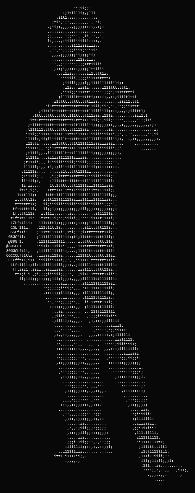
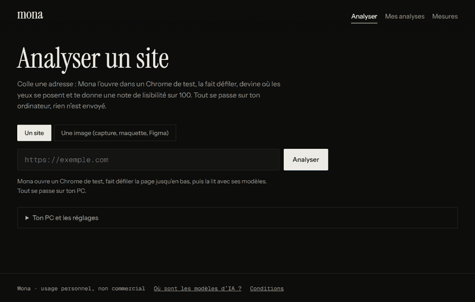

# Mona (en local)

<p align="center"></p>

<p align="center"></p>

Colle une adresse de site. Mona l'ouvre dans ton propre Chrome, la fait défiler, prédit **où les yeux se posent**, **comment le cerveau réagit**, vérifie 6 règles de lisibilité et donne une **note sur 100**. Tout se passe sur ton ordinateur : les modèles d'IA (ONNX) tournent dans ton navigateur, rien n'est envoyé ailleurs, sauf la visite du site que tu analyses.

English: [README.md](README.md) · Site et mesures : <https://liamlitle.github.io/mona/>

## Démarrage rapide

Il faut Python 3.10 ou plus.

```bash
pip install -r requirements.txt
playwright install chromium
python server/app.py
```

Ton navigateur s'ouvre sur `http://127.0.0.1:8765`. Tape une adresse, clique sur **Analyser**. La première fois, les modèles (environ 60 Mo) se chargent, puis restent en cache.

Autres entrées sur la même page : l'onglet **Image** (capture d'écran, maquette, export Figma, sans navigateur de capture) et **« Analyser un site déjà ouvert dans un autre onglet »** (le navigateur partage un seul onglet avec Mona, rien d'autre de ton écran).

Réglages (variables d'environnement) : `MONA_PORT` (8765 par défaut), `MONA_MAX_SCREENS` (12 par défaut), `MONA_NO_BROWSER=1`.

## Contenu

| Dossier | Contenu |
|---|---|
| `web/` | L'interface de Mona et les modèles dans `web/models/` (regard ×2, cerveau, détecteur d'éléments) |
| `server/` | Petit serveur local : ouvre les adresses avec Playwright et sert `web/`. Il n'écoute que sur `127.0.0.1` et refuse les requêtes venant d'autres pages web |
| `cli/` | `mona_cli.py` : ligne de commande sur une image (carte de chaleur, profil du cerveau, éléments repérés) |

```bash
pip install -r cli/requirements.txt
python cli/mona_cli.py capture.png
```

## Est-ce fiable ?

Mesuré sur des cas jamais vus à l'entraînement : corrélation du regard de 0,68 avec de vrais regards (UEyes) et 0,56 sur des pages web d'un autre jeu de données ; détecteur d'éléments F1 0,64 ; depuis une image seule, la note s'écarte en moyenne de 5,5 points sur 100 de celle calculée avec le code de la page. Le modèle du cerveau vient d'une seule personne : une indication, pas un diagnostic. Mona mesure la lisibilité et l'attention, pas le goût. Détails : <https://liamlitle.github.io/mona/benchmarks.html>.

## Licence

**Mona Personal Use License** (voir [LICENSE](LICENSE), avec traduction française) : utilise-la pour toi, gratuitement. **Pas** de redistribution, **pas** de vente, **pas** d'usage pour gagner de l'argent (y compris travail pour des clients et services en ligne), **pas** d'entraînement d'autres modèles avec, et un **crédit visible** (« Mona par Liam Litle ») dès que tu montres ou publies quelque chose qui l'utilise. C'est du *source-available*, pas de l'open source. Pour tout autre usage, demande d'abord à l'auteur. Les données d'entraînement et les poids préentraînés ont leurs propres conditions : voir [NOTICE.md](NOTICE.md).
